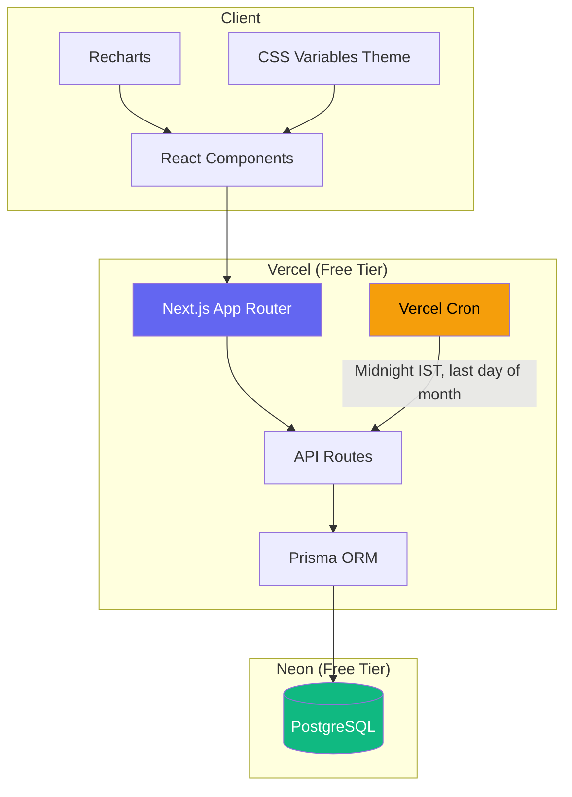
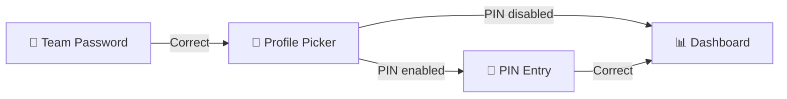

# 🎯 Team Goal Tracker — Implementation Plan

## Goal Description

Build a **Team Goal Tracker** web app for a fixed 7-person team. Members set yearly and monthly goals, track progress with editable progress bars, see each other's goals, earn scores, and take penalties for falling behind. Nothing is ever deleted, and every edit is logged with full audit trail.

The MVP focuses on the core goal-setting → progress tracking → scoring loop, with the penalty system and radar chart as key motivational features.

---

## User Review Required

> [!IMPORTANT]
> **Tech Stack Decision:** Based on the Decision Council analysis, we're going with **Next.js 14 + Neon PostgreSQL + Prisma + Vercel** (all free tier). Review the [Decision Council](file:///C:/Users/Admin/.gemini/antigravity-ide/brain/c2d43e29-38a0-4eab-8f03-4447f0748ee2/decision_council_tech_stack.md) for the full rationale.

> [!WARNING]
> **MVP Scope Cut:** The following features are deferred to later phases to ship the MVP faster:
> - ❌ Quest Stack (Phase 2)
> - ❌ Reports & PDF/CSV Export (Phase 2)
> - ❌ Email notifications (Phase 3)
> - ❌ Reward tiers (Phase 3)
> 
> All deferred features are accounted for in the data model — no migration needed later.

> [!IMPORTANT]
> **Radar Chart Clarification:** Based on your input:
> - **Team Dashboard:** One radar chart where each axis = a team member, value = their current month's overall %
> - **Personal Page:** Individual radar chart where each axis = a month (Jan–Dec), showing that person's monthly % over time
> 
> This is different from the original plan's "category-based radar". The `categories` table is kept for future use but not used in MVP.

---

## Open Questions

> [!IMPORTANT]
> **Q1: Team Password.** What should the initial shared team password be? (Can be changed later by admin)

> [!IMPORTANT]
> **Q2: Admin Password.** What should the initial admin password be?

> [!NOTE]
> **Q3: Default Cutoff Day.** The registration cutoff day is configurable. The default will be set to **day 5** of each month (goals must be registered by the 5th). Is this reasonable, or do you prefer a different default?

---

## Architecture Overview



---

## Proposed Changes

### File Structure

```
team-goal-tracker/
├── prisma/
│   ├── schema.prisma          # Full data model
│   ├── seed.ts                # Seed 7 placeholder members + settings
│   └── migrations/
├── src/
│   ├── app/
│   │   ├── layout.tsx         # Root layout, theme provider, Inter font
│   │   ├── page.tsx           # Login page (team password)
│   │   ├── globals.css        # CSS variables, theme tokens, base styles
│   │   ├── pick-profile/
│   │   │   └── page.tsx       # Profile picker (7 avatars)
│   │   ├── dashboard/
│   │   │   └── page.tsx       # Team dashboard
│   │   ├── member/
│   │   │   └── [id]/
│   │   │       └── page.tsx   # Personal page
│   │   ├── goals/
│   │   │   └── register/
│   │   │       └── page.tsx   # Goal registration form
│   │   ├── leaderboard/
│   │   │   └── page.tsx       # Leaderboard + team radar
│   │   ├── activity/
│   │   │   └── page.tsx       # Activity log (filterable)
│   │   ├── admin/
│   │   │   └── page.tsx       # Admin settings panel
│   │   └── api/
│   │       ├── auth/
│   │       │   ├── login/route.ts       # Team password check
│   │       │   ├── verify-pin/route.ts  # PIN verification
│   │       │   └── admin/route.ts       # Admin password check
│   │       ├── members/
│   │       │   ├── route.ts             # GET all, PATCH profile
│   │       │   └── [id]/route.ts        # GET single member
│   │       ├── goals/
│   │       │   ├── route.ts             # GET/POST goals
│   │       │   └── [id]/
│   │       │       ├── route.ts         # PATCH goal
│   │       │       └── progress/route.ts # POST progress update
│   │       ├── snapshots/
│   │       │   └── route.ts             # GET monthly snapshots
│   │       ├── penalties/
│   │       │   ├── route.ts             # GET penalty ledger
│   │       │   └── events/route.ts      # GET/PATCH penalty events
│   │       ├── audit/
│   │       │   └── route.ts             # GET audit log
│   │       ├── settings/
│   │       │   └── route.ts             # GET/PATCH team settings
│   │       ├── years/
│   │       │   └── route.ts             # GET/POST years
│   │       └── cron/
│   │           └── month-close/route.ts # Cron endpoint
│   ├── components/
│   │   ├── ui/
│   │   │   ├── Button.tsx
│   │   │   ├── Card.tsx
│   │   │   ├── ProgressBar.tsx
│   │   │   ├── Modal.tsx
│   │   │   ├── Badge.tsx
│   │   │   ├── Tabs.tsx
│   │   │   ├── Avatar.tsx           # Initials in colored circle
│   │   │   ├── ThemeToggle.tsx
│   │   │   └── CountdownTimer.tsx   # Registration cutoff countdown
│   │   ├── charts/
│   │   │   ├── TeamRadar.tsx        # All 7 members on one radar
│   │   │   ├── PersonalRadar.tsx    # One member, months as axes
│   │   │   └── ScoreBar.tsx         # Score comparison bars
│   │   ├── dashboard/
│   │   │   ├── MemberCard.tsx       # Avatar, name, %, penalty, status
│   │   │   ├── TeamHeader.tsx       # Top scorer, reward progress, cutoff
│   │   │   └── DashboardGrid.tsx
│   │   ├── goals/
│   │   │   ├── YearlyGoal.tsx
│   │   │   ├── MonthlyGoalCard.tsx
│   │   │   ├── GoalForm.tsx
│   │   │   └── ProgressEditor.tsx   # Editable progress bar with note
│   │   ├── profile/
│   │   │   ├── ProfileHeader.tsx
│   │   │   ├── ProfilePicker.tsx
│   │   │   └── PINInput.tsx
│   │   ├── activity/
│   │   │   └── AuditTimeline.tsx
│   │   └── admin/
│   │       ├── YearManager.tsx
│   │       ├── SettingsForm.tsx
│   │       └── PenaltyManager.tsx
│   ├── lib/
│   │   ├── prisma.ts              # Prisma client singleton
│   │   ├── session.ts             # iron-session config
│   │   ├── audit.ts               # Auto audit-log writer
│   │   ├── scoring.ts             # Monthly %, penalty, score calculation
│   │   ├── theme.ts               # Theme context provider
│   │   └── constants.ts           # Status colors, default settings
│   └── types/
│       └── index.ts               # TypeScript interfaces
├── vercel.json                    # Cron job config
├── package.json
├── tsconfig.json
├── next.config.js
└── .env.local                     # DATABASE_URL, SESSION_PASSWORD
```

---

### Database — Prisma Schema

#### [NEW] `prisma/schema.prisma`

```prisma
generator client {
  provider = "prisma-client-js"
}

datasource db {
  provider = "postgresql"
  url      = env("DATABASE_URL")
}

model Member {
  id        String   @id @default(cuid())
  name      String
  email     String?
  phone     String?
  dob       DateTime?
  avatarColor String @default("#6366f1")
  isAdmin   Boolean  @default(false)
  pinHash   String?  // bcrypt hash of 4-digit PIN
  createdAt DateTime @default(now())
  updatedAt DateTime @updatedAt

  goals           Goal[]
  progressUpdates ProgressUpdate[] @relation("ProgressActor")
  snapshots       MonthlySnapshot[]
  penaltyLedger   PenaltyLedgerEntry[]
  penaltyEvents   PenaltyEvent[]
  auditLogsAsActor  AuditLog[] @relation("AuditActor")
  auditLogsAsTarget AuditLog[] @relation("AuditTarget")
}

model TeamSettings {
  id                 String  @id @default("singleton")
  passwordHash       String  // bcrypt hash of team password
  adminPasswordHash  String  // bcrypt hash of admin password
  cutoffDay          Int     @default(5) // Day of month goals lock
  thresholds         Json    @default("{\"safe\":75,\"warning\":50,\"danger\":0}")
  penaltyPoints      Json    @default("{\"safe\":0,\"warning\":5,\"danger\":10,\"notStarted\":25}")
  penaltyThreshold   Int     @default(100) // Points before party trigger
  rewardTiersEnabled Boolean @default(false)
  selfEditOnly       Boolean @default(true) // Members edit only own goals
  pinsEnabled        Boolean @default(true)
  timezone           String  @default("Asia/Kolkata")
}

model Year {
  id       String  @id @default(cuid())
  label    String  @unique // e.g., "2026"
  isActive Boolean @default(false)

  goals     Goal[]
  snapshots MonthlySnapshot[]
  rewards   TeamReward[]
}

model Category {
  id    String @id @default(cuid())
  name  String @unique // Radar axes (future use)
  goals Goal[]
}

model Goal {
  id              String    @id @default(cuid())
  memberId        String
  yearId          String
  type            GoalType  // YEARLY or MONTHLY
  month           Int?      // 1-12 for monthly, null for yearly
  title           String
  target          String?   // Description of target
  currentProgress Int       @default(0) // 0-100
  categoryId      String?
  deadline        DateTime? // For yearly goals
  isDone          Boolean   @default(false)
  lockedAt        DateTime? // When goals were locked (after cutoff)
  archivedAt      DateTime?
  createdAt       DateTime  @default(now())
  updatedAt       DateTime  @updatedAt

  member   Member    @relation(fields: [memberId], references: [id])
  year     Year      @relation(fields: [yearId], references: [id])
  category Category? @relation(fields: [categoryId], references: [id])

  progressUpdates ProgressUpdate[]
}

enum GoalType {
  YEARLY
  MONTHLY
}

model ProgressUpdate {
  id        String   @id @default(cuid())
  goalId    String
  oldValue  Int
  newValue  Int
  note      String?
  actorId   String   // Who made the change
  createdAt DateTime @default(now())

  goal  Goal   @relation(fields: [goalId], references: [id])
  actor Member @relation("ProgressActor", fields: [actorId], references: [id])

  // Append-only: no UPDATE or DELETE
}

model MonthlySnapshot {
  id       String   @id @default(cuid())
  memberId String
  yearId   String
  month    Int      // 1-12
  percent  Float    // Average of monthly goal progress
  penalty  Int      // Penalty points earned this month
  score    Float    // percent - penalty
  closedAt DateTime @default(now())

  member Member @relation(fields: [memberId], references: [id])
  year   Year   @relation(fields: [yearId], references: [id])

  @@unique([memberId, yearId, month])
  // Immutable: no UPDATE or DELETE
}

model PenaltyLedgerEntry {
  id        String   @id @default(cuid())
  memberId  String
  points    Int
  reason    String   // e.g., "Month 3: 45% avg → 10 points"
  month     Int
  createdAt DateTime @default(now())

  member Member @relation(fields: [memberId], references: [id])
}

model PenaltyEvent {
  id          String    @id @default(cuid())
  memberId    String
  triggeredAt DateTime  @default(now())
  type        String    @default("party") // Type of penalty
  paidAt      DateTime? // null until admin marks paid
  note        String?

  member Member @relation(fields: [memberId], references: [id])
}

model TeamReward {
  id       String  @id @default(cuid())
  yearId   String
  month    Int
  unlocked Boolean @default(false)
  note     String?

  year Year @relation(fields: [yearId], references: [id])

  @@unique([yearId, month])
}

model AuditLog {
  id             String   @id @default(cuid())
  actorId        String   // Who made the change
  targetMemberId String?  // Whose data was changed
  entity         String   // "goal", "member", "settings", etc.
  entityId       String   // ID of the changed record
  action         String   // "create", "update", "archive"
  oldValue       Json?    // Previous state
  newValue       Json?    // New state
  createdAt      DateTime @default(now())

  actor        Member  @relation("AuditActor", fields: [actorId], references: [id])
  targetMember Member? @relation("AuditTarget", fields: [targetMemberId], references: [id])

  // Append-only: no UPDATE or DELETE
}
```

---

### Authentication System

#### [NEW] `src/lib/session.ts` — Iron Session Configuration

```typescript
import { getIronSession } from 'iron-session';
import { cookies } from 'next/headers';

export interface SessionData {
  isLoggedIn: boolean;
  memberId: string | null;
  memberName: string | null;
  isAdmin: boolean;
}

const sessionOptions = {
  password: process.env.SESSION_PASSWORD!, // 32+ character secret
  cookieName: 'team-goal-tracker',
  cookieOptions: {
    secure: process.env.NODE_ENV === 'production',
    httpOnly: true,
    sameSite: 'lax' as const,
    maxAge: 60 * 60 * 24 * 30, // 30 days
  },
};

export async function getSession() {
  const cookieStore = await cookies();
  return getIronSession<SessionData>(cookieStore, sessionOptions);
}
```

**Auth flow:**
1. User enters team password → verified against `TeamSettings.passwordHash` (bcrypt)
2. User picks their profile from 7 avatars → stored in session as `memberId`
3. If PINs enabled, user enters 4-digit PIN → verified against `Member.pinHash`
4. Session contains: `isLoggedIn`, `memberId`, `memberName`, `isAdmin`
5. Admin features require separate admin password verification

---

### Core Business Logic

#### [NEW] `src/lib/scoring.ts` — Scoring Engine

```typescript
interface GoalProgress {
  currentProgress: number; // 0-100
}

interface PenaltyConfig {
  safe: number;      // threshold: 75
  warning: number;   // threshold: 50
  danger: number;    // threshold: 0
}

interface PenaltyPointConfig {
  safe: number;       // 0
  warning: number;    // 5
  danger: number;     // 10
  notStarted: number; // 25
}

/**
 * Calculate the equal-weight average of monthly goal progress.
 * Each goal has equal weight: 4 goals = 25% each.
 */
export function calculateMonthlyPercent(goals: GoalProgress[]): number {
  if (goals.length === 0) return 0;
  const sum = goals.reduce((acc, g) => acc + g.currentProgress, 0);
  return Math.round(sum / goals.length);
}

/**
 * Determine penalty points based on monthly average %.
 * 
 * Boundary rules:
 * - ≥ 75% → 0 (safe)
 * - 50% to < 75% → 5 (warning)
 * - > 0% to < 50% → 10 (danger)
 * - 0% with no progress recorded → 25 (not started)
 */
export function calculatePenalty(
  percent: number,
  hasAnyProgress: boolean,
  thresholds: PenaltyConfig,
  points: PenaltyPointConfig
): number {
  if (percent >= thresholds.safe) return points.safe;        // ≥ 75
  if (percent >= thresholds.warning) return points.warning;  // 50–74
  if (percent > thresholds.danger && hasAnyProgress) return points.danger; // 1–49
  return points.notStarted; // 0 with no progress = 25
}

/**
 * Calculate monthly score: round(monthly %) − penalty points
 */
export function calculateScore(percent: number, penalty: number): number {
  return Math.round(percent) - penalty;
}
```

#### [NEW] `src/lib/audit.ts` — Audit Log Middleware

```typescript
import { prisma } from './prisma';

/**
 * Write an audit log entry. This is called by every mutation endpoint.
 * The actor comes from the session — never trust the client.
 */
export async function writeAuditLog(params: {
  actorId: string;
  targetMemberId?: string;
  entity: string;
  entityId: string;
  action: 'create' | 'update' | 'archive';
  oldValue?: any;
  newValue?: any;
}) {
  await prisma.auditLog.create({
    data: {
      actorId: params.actorId,
      targetMemberId: params.targetMemberId,
      entity: params.entity,
      entityId: params.entityId,
      action: params.action,
      oldValue: params.oldValue ?? null,
      newValue: params.newValue ?? null,
    },
  });
}
```

---

### Month-Close Cron Job

#### [NEW] `src/app/api/cron/month-close/route.ts`

```typescript
// Triggered by Vercel Cron at midnight IST on the last day of each month
// Also callable manually by admin via POST with admin auth

export async function GET(request: Request) {
  // Verify cron secret (Vercel sends CRON_SECRET header)
  const authHeader = request.headers.get('authorization');
  if (authHeader !== `Bearer ${process.env.CRON_SECRET}`) {
    return Response.json({ error: 'Unauthorized' }, { status: 401 });
  }

  // Algorithm:
  // 1. Get the active year and current month
  // 2. For each of the 7 members:
  //    a. Get all monthly goals for this month
  //    b. Calculate equal-weight average (monthly %)
  //    c. Determine penalty points from thresholds
  //    d. Calculate score = round(%) - penalty
  //    e. Write immutable MonthlySnapshot
  //    f. Add penalty to PenaltyLedgerEntry
  //    g. Check if running penalty total ≥ 100
  //       → If yes: create PenaltyEvent (party), notify all
  // 3. Check if ALL 7 members hit 100% → TeamReward.unlocked = true
  // 4. Lock all goals for this month (set lockedAt)
}
```

#### [NEW] `vercel.json` — Cron Configuration

```json
{
  "crons": [
    {
      "path": "/api/cron/month-close",
      "schedule": "30 18 L * *"
    }
  ]
}
```

> `30 18 L * *` = 18:30 UTC = 00:00 IST (midnight) on the last day of each month.
> Note: Vercel free tier supports 1 cron job per day. We'll use "last day of month" scheduling.

---

### Theme System

#### [NEW] `src/app/globals.css` — Design Tokens

```css
/* ═══════════════════════════════════════════
   THEME SYSTEM — Dark & Light
   ═══════════════════════════════════════════ */

:root {
  /* Dark theme (default) */
  --bg-primary: #0b0b14;
  --bg-card: #13131f;
  --bg-card-hover: #1a1a2e;
  --bg-input: #1a1a2e;
  --border-subtle: rgba(99, 102, 241, 0.15);
  --border-card: rgba(255, 255, 255, 0.06);

  --text-primary: #f1f1f7;
  --text-secondary: #8b8ba3;
  --text-muted: #5a5a72;

  --accent: #6366f1;
  --accent-glow: rgba(99, 102, 241, 0.3);
  --accent-hover: #818cf8;

  --status-safe: #22c55e;
  --status-warning: #f59e0b;
  --status-danger: #f97316;
  --status-critical: #ef4444;

  --radius-sm: 8px;
  --radius-md: 12px;
  --radius-lg: 16px;
  --radius-full: 9999px;

  --shadow-card: 0 4px 24px rgba(0, 0, 0, 0.3);
  --shadow-glow: 0 0 20px var(--accent-glow);

  --font-sans: 'Inter', -apple-system, sans-serif;
  --transition: 200ms cubic-bezier(0.4, 0, 0.2, 1);
}

[data-theme="light"] {
  --bg-primary: #f8f9fc;
  --bg-card: #ffffff;
  --bg-card-hover: #f1f3f9;
  --bg-input: #f1f3f9;
  --border-subtle: rgba(99, 102, 241, 0.2);
  --border-card: rgba(0, 0, 0, 0.08);

  --text-primary: #111827;
  --text-secondary: #6b7280;
  --text-muted: #9ca3af;

  --shadow-card: 0 4px 24px rgba(0, 0, 0, 0.08);
}
```

---

### Screen-by-Screen Component Breakdown

#### Screen 1: Login → Profile Picker



| Component | Details |
|-----------|---------|
| Password input | Single field, bcrypt compare, "Enter team password" |
| Profile picker | 7 circular avatars (initials + color), names below, click to select |
| PIN input | 4-digit numeric, shown only if `TeamSettings.pinsEnabled` && `Member.pinHash` exists |
| Session | Stores `memberId`, `memberName`, `isAdmin` in iron-session cookie |

#### Screen 2: Team Dashboard

| Component | Details |
|-----------|---------|
| `TeamHeader` | Top scorer badge, reward progress ("5/7 at 100%"), cutoff countdown |
| `MemberCard` × 7 | Avatar (initials circle), name, current month %, penalty points, status color border |
| `TeamRadar` | Recharts RadarChart: 7 axes = members, values = monthly %, single polygon |
| Status colors | Border glow: green (≥75%), amber (50–74%), orange (1–49%), red (0%/not started) |
| Navigation | Bottom nav bar: Dashboard / My Goals / Leaderboard / Activity / Admin |

#### Screen 3: Personal Page

| Section | Details |
|---------|---------|
| `ProfileHeader` | Avatar, name, email, phone, DOB, edit button (self or admin only) |
| `YearlyGoal` | Title, deadline, done checkbox, progress bar |
| Monthly Goals | Cards with: title, editable progress bar, note input, weight label ("25%") |
| `PersonalRadar` | RadarChart: 12 axes = months, value = that month's %, shows yearly trend |
| Stats | Month average %, total penalty points, yearly score |
| `AuditTimeline` | Recent changes for this member, newest first |

#### Screen 4: Goal Registration

| Component | Details |
|-----------|---------|
| Cutoff countdown | "3 days left to register goals for November" |
| Goal form | Title, target description, optional category |
| Weight display | Dynamic: "4 goals registered = 25% weight each" |
| Lock status | After cutoff: form disabled, "Goals locked for this month" banner |

#### Screen 5: Leaderboard

| Component | Details |
|-----------|---------|
| Monthly top scorer | Crown badge, name, score, with tie-break rule shown |
| Yearly standings | Ranked list: name, yearly score, total penalties |
| Penalty table | Member → total points → status (danger if near 100) |
| Team radar | Same as dashboard radar, larger view |

#### Screen 6: Activity Log

| Component | Details |
|-----------|---------|
| Filter controls | By member, by action type, by date range |
| Log table | Actor, target member, entity, action, old→new value, timestamp |
| Pagination | Server-side, 50 per page |

#### Screen 7: Admin Panel

| Component | Details |
|-----------|---------|
| Year manager | Create year, set active year, switch/view old years |
| Cutoff settings | Cutoff day picker, timezone display |
| Threshold editor | Penalty thresholds (75/50/0) and points (0/5/10/25) |
| PIN toggle | Enable/disable PIN requirement |
| Penalty manager | List pending penalties, mark as paid/done, view history |
| Manual month-close | "Close Month Now" button (triggers cron endpoint) |
| Override log | Admin edits on closed months require a reason |

---

### API Route Specifications

| Method | Route | Purpose | Auth Required |
|--------|-------|---------|---------------|
| `POST` | `/api/auth/login` | Verify team password | None |
| `POST` | `/api/auth/verify-pin` | Verify member PIN | Session |
| `POST` | `/api/auth/admin` | Verify admin password | Session |
| `GET` | `/api/members` | List all 7 members | Session |
| `GET` | `/api/members/[id]` | Get single member details | Session |
| `PATCH` | `/api/members/[id]` | Update profile (self/admin) | Session + ownership |
| `GET` | `/api/goals?memberId=&yearId=&month=` | Get goals (filtered) | Session |
| `POST` | `/api/goals` | Create a goal | Session + pre-cutoff |
| `PATCH` | `/api/goals/[id]` | Update goal (title/target, pre-cutoff only) | Session + ownership |
| `POST` | `/api/goals/[id]/progress` | Update progress (always allowed) | Session + audit |
| `GET` | `/api/snapshots?memberId=&yearId=` | Get monthly snapshots | Session |
| `GET` | `/api/penalties` | Get penalty ledger | Session |
| `GET` | `/api/penalties/events` | Get penalty events | Session |
| `PATCH` | `/api/penalties/events/[id]` | Mark penalty as paid | Admin |
| `GET` | `/api/audit?memberId=&entity=&page=` | Get audit log (filtered) | Session |
| `GET/PATCH` | `/api/settings` | Read/update team settings | Admin for PATCH |
| `GET/POST` | `/api/years` | List/create years | Admin for POST |
| `GET` | `/api/cron/month-close` | Execute month-close | Cron secret |

---

### No-Delete Enforcement

```typescript
// In prisma.ts — Prisma middleware that blocks all DELETE operations
prisma.$use(async (params, next) => {
  if (params.action === 'delete' || params.action === 'deleteMany') {
    throw new Error(
      `DELETE operations are forbidden. Use archive instead. ` +
      `Attempted to delete from ${params.model}`
    );
  }
  return next(params);
});
```

Additionally, the PostgreSQL database will have a trigger:
```sql
-- Prevent DELETE on all tables
CREATE OR REPLACE FUNCTION prevent_delete()
RETURNS TRIGGER AS $$
BEGIN
  RAISE EXCEPTION 'DELETE operations are not allowed on %', TG_TABLE_NAME;
END;
$$ LANGUAGE plpgsql;

-- Apply to all tables
CREATE TRIGGER no_delete_members BEFORE DELETE ON "Member" FOR EACH ROW EXECUTE FUNCTION prevent_delete();
-- ... repeated for all tables
```

---

## Phase Breakdown (MVP → Full)

### 🟢 Phase 1: MVP (This Implementation)

| Feature | Status |
|---------|--------|
| Team password login + profile picker | ✅ Build |
| 4-digit PIN verification | ✅ Build |
| Team dashboard with 7 member cards | ✅ Build |
| Personal page with profile + goals | ✅ Build |
| Yearly goal (title, deadline, done checkbox) | ✅ Build |
| Monthly goal creation with cutoff lock | ✅ Build |
| Editable progress bars with notes | ✅ Build |
| Audit log (auto-written on every mutation) | ✅ Build |
| Month-close cron job (scoring + penalties) | ✅ Build |
| Penalty engine + 100-point party trigger | ✅ Build |
| Team radar chart (7 members as axes) | ✅ Build |
| Personal radar chart (12 months as axes) | ✅ Build |
| Leaderboard + top scorer | ✅ Build |
| Activity log (filterable) | ✅ Build |
| Admin panel (settings, year, penalties) | ✅ Build |
| Dark/Light theme toggle | ✅ Build |
| All-7-at-100% team reward check | ✅ Build |
| Responsive layout (desktop-first) | ✅ Build |

### 🟡 Phase 2: Enhancements (Later)

| Feature | Status |
|---------|--------|
| Quest Stack (task list linked to goals) | ⏳ Deferred |
| Reports (per-person, team, monthly, yearly) | ⏳ Deferred |
| PDF/CSV export | ⏳ Deferred |

### 🔵 Phase 3: Advanced (Later)

| Feature | Status |
|---------|--------|
| Email reminders (cutoff approaching, penalties) | ⏳ Deferred |
| Reward tiers (configurable) | ⏳ Deferred |
| Push notifications | ⏳ Deferred |

### 🟣 Phase 4: Pilot (After Phase 1)

| Feature | Status |
|---------|--------|
| Real team testing for 1 full month | ⏳ After MVP |
| Bug fixes and UX refinements | ⏳ After MVP |

---

## Verification Plan

### Automated Tests

```bash
# Run all tests
npm test

# Run specific test suites
npm test -- --testPathPattern=scoring   # Penalty boundary tests
npm test -- --testPathPattern=audit     # Audit log tests
npm test -- --testPathPattern=goals     # Goal lock tests
```

**Test cases from the plan (Section 8):**

| Test | Input | Expected Output |
|------|-------|-----------------|
| Penalty: 0% no progress | `percent=0, hasProgress=false` | 25 points |
| Penalty: 0.01% | `percent=0.01, hasProgress=true` | 10 points |
| Penalty: 49.99% | `percent=49.99, hasProgress=true` | 10 points |
| Penalty: exactly 50% | `percent=50, hasProgress=true` | 5 points |
| Penalty: 74.99% | `percent=74.99, hasProgress=true` | 5 points |
| Penalty: exactly 75% | `percent=75, hasProgress=true` | 0 points |
| Penalty: 100% | `percent=100, hasProgress=true` | 0 points |
| Equal-weight avg: 1 goal at 80% | `[80]` | 80% |
| Equal-weight avg: 3 goals | `[100, 50, 30]` | 60% |
| Equal-weight avg: 4 goals | `[100, 75, 50, 25]` | 63% |
| Equal-weight avg: 7 goals | `[100,90,80,70,60,50,40]` | 70% |
| Lock: edit after cutoff | PATCH goal title after lock | 403 error |
| Lock: progress after cutoff | POST progress after lock | 200 OK (allowed) |
| Delete: API delete request | DELETE /api/goals/123 | 405 Method Not Allowed |
| Delete: Prisma delete | `prisma.goal.delete()` | Error thrown |
| Audit: progress update | POST progress | 1 audit entry with correct fields |
| Penalty reset: at 100 | Total reaches 100+ | PenaltyEvent created, counter reset after paid |
| Reward: all 7 at 100% | All snapshots = 100% | TeamReward.unlocked = true |
| Reward: 6/7 at 100% | One member at 95% | TeamReward.unlocked = false |

### Manual Verification

1. **Login flow:** Enter wrong password → error. Enter correct → profile picker. Pick a profile → PIN prompt. Enter correct PIN → dashboard.
2. **Goal creation:** Create 4 monthly goals → see "25% weight each". Try to edit after cutoff → blocked.
3. **Progress update:** Drag progress bar → see new % reflected, audit log updated, note saved.
4. **Theme toggle:** Switch between dark and light → all pages render correctly.
5. **Admin panel:** Change cutoff day, mark penalty as paid, create a new year.
6. **Radar charts:** Team radar shows all 7 members. Personal radar shows monthly history.
7. **Mobile layout:** Resize browser to 375px width → layout adapts without horizontal scroll.

---

## Refined Master Prompt

> [!TIP]
> This is the refined, production-grade prompt for the build, incorporating all decisions from the interview and Decision Council.

```
Build a mobile-responsive web app called "Team Goal Tracker" for a fixed 7-person team.

STACK: Next.js 14 (App Router), Neon PostgreSQL (free tier), Prisma ORM, Recharts,
iron-session for auth, CSS Variables for theming, deployed to Vercel (free tier).

AUTH:
- Single shared team password (bcrypt hash in TeamSettings table)
- Profile picker: 7 members shown as circular avatar (initials + color), click to select
- 4-digit PIN per member (enabled by default, bcrypt hashed)
- Separate admin password for settings panel
- Session stored via iron-session cookie (30-day expiry)

GOALS:
- 1 yearly goal per member: title, deadline, done checkbox
- Monthly goals: title, target, progress (0-100%), created before a configurable cutoff day
- After cutoff: goals lock (title/target immutable), but progress can still be updated
- Equal-weight average: N goals = 100/N% weight each
- Progress bar: editable slider, requires a note on each update
- Every progress change creates an append-only ProgressUpdate record

SCORING (month-close, triggered by Vercel Cron at midnight IST on last day of month):
- Monthly % = equal-weight average of monthly goal progress values
- Penalty points: ≥75% → 0, 50–74% → 5, 1–49% → 10, 0% not started → 25
- Monthly score = round(monthly %) - penalty points
- Yearly score = sum of monthly scores
- Top scorer: highest yearly score, tiebreak = fewer penalty points
- All thresholds stored in TeamSettings.thresholds (JSON), not hardcoded

PENALTIES:
- Running total tracked in PenaltyLedgerEntry table
- When total ≥ 100: create PenaltyEvent (type: "party"), visible to all 7
- Counter resets to 0 only after admin marks PenaltyEvent as paid
- Full history preserved

REWARD:
- If ALL 7 members reach 100% monthly average in a month → TeamReward.unlocked = true
- All-or-nothing (no tiers in MVP)

DATA RULES:
- Nothing is ever deleted. All tables: archive only (set archivedAt timestamp)
- Prisma middleware blocks DELETE/deleteMany operations
- PostgreSQL trigger as second layer of defense
- ProgressUpdate, AuditLog, MonthlySnapshot tables are append-only
- Every mutation auto-writes AuditLog: actorId, targetMemberId, entity, entityId,
  action, oldValue (JSON), newValue (JSON), server timestamp (IST)

SCREENS:
1. Login: team password input → profile picker → PIN input (if enabled) → dashboard
2. Team Dashboard: header (top scorer, reward progress "5/7 at 100%", cutoff countdown),
   7 MemberCards (avatar, name, month %, penalty points, status color border),
   TeamRadar chart (7 axes = members, values = their monthly %)
3. Personal Page: profile info, yearly goal, monthly goals with editable progress bars,
   PersonalRadar (12 axes = months, values = monthly %), stats, recent audit timeline
4. Goal Registration: form with cutoff countdown, dynamic weight display
5. Leaderboard: monthly/yearly rankings, penalty standings, team radar
6. Activity Log: filterable table (by member, action, date), paginated
7. Admin: year manager, cutoff settings, threshold editor, PIN toggle,
   penalty manager (mark paid), manual month-close button, override logging

DESIGN:
- Dark theme default: bg #0b0b14, cards #13131f, accent #6366f1 (indigo)
- Light theme toggle: bg #f8f9fc, cards #ffffff, same accent
- CSS Variables for all theme tokens, [data-theme="light"] override
- Status colors: green ≥75%, amber 50-74%, orange 1-49%, red 0%
- Inter font, bold section titles with emoji prefix, muted grey secondary text
- Rounded corners (12-16px), subtle borders, card shadows
- Progress bars: thick, rounded, color = status threshold
- Smooth transitions (200ms), hover effects, micro-animations
- Avatars: initials in colored circles
- Desktop-first with responsive breakpoints for mobile

DO NOT:
- Delete any record, ever
- Hardcode penalty thresholds or points
- Trust client-side timestamps (use server time in IST)
- Allow goal title/target edits after cutoff (progress is OK)
- Allow non-admin to edit another member's goals (when selfEditOnly = true)
- Skip audit logging on any mutation
```

---

## Summary of Decisions Made

| Decision | Choice | Rationale |
|----------|--------|-----------|
| Hosting | Vercel (free) | No cold starts, native Next.js, free cron |
| Database | Neon PostgreSQL (free) | 512MB, Prisma-native, PITR backups |
| Framework | Next.js 14 (App Router) | API routes for server-side enforcement |
| Auth | iron-session + bcrypt | Fits shared-password + PIN model |
| Charts | Recharts | RadarChart + BarChart, React-native |
| Styling | CSS Variables + Modules | Theme switching, no dependencies |
| Avatars | Initials in colored circles | Simple, no upload needed |
| PINs | Enabled by default | Real accountability requested |
| Theme | Dark + Light toggle | Both from day 1 |
| Email | Deferred | Not needed for MVP |
| Quest Stack | Deferred | Phase 2 |
| Reports | Deferred | Phase 2 |
| Team Radar | 7 axes = members | Each axis shows a member's monthly % |
| Personal Radar | 12 axes = months | Shows progress trend over the year |
| Month-close | Auto cron + manual button | Vercel Cron at midnight IST + admin fallback |
| Cutoff day | Configurable, default 5 | Admin sets via settings panel |
| Scope | MVP first, then iterate | Ship core loop fast, add features later |
